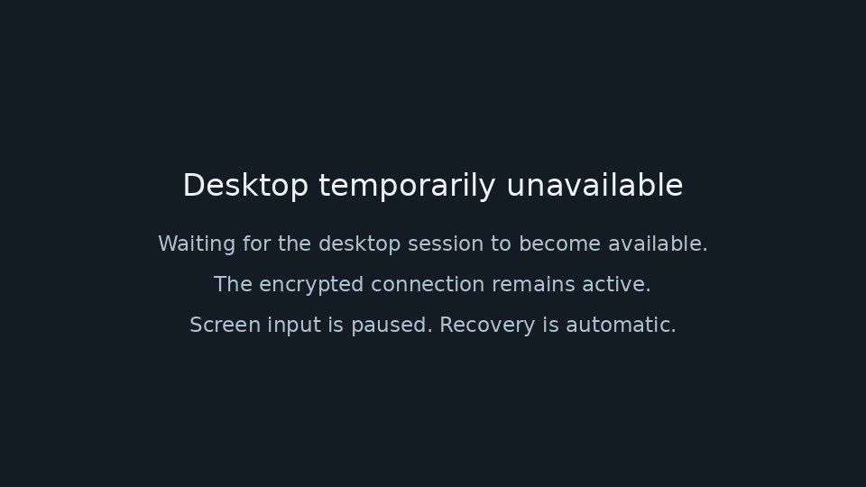

# RDP 中斷後的 Lattice Remote 擷取恢復

## 問題與修正

使用者提供的畫面顯示：Windows RDP 開啟時 Lattice Remote 可串流；中斷
RDP 後，主機仍開機，viewer 卻顯示配對碼遭拒。尚未取得該主機當次的
GDI 錯誤碼，不能把畫面對照當成完整的實機根因重現。

已用真實加密協定重現：正確配對碼握手成功後，只要 Agent 在 Hello 前
結束，原 viewer 也會誤報配對碼錯誤。原 Agent 又把首次桌面擷取放在
Hello 前，後續擷取失敗則會結束整個工作階段。

修正將認證後的工作階段與桌面是否可擷取分離。桌面不可用時傳送既有
JPEG frame 格式的狀態畫面，不新增遠端協定訊息；已授權的其他功能
仍由原 receiver 處理。無有效桌面時禁止輸入、釋放按鍵，恢復後重建
座標映射，丟棄舊世代輸入。暫停時停止擷取，恢復時不重播舊桌面。

OS 擷取使用每個 Agent 程序唯一的 worker，佇列容量為一，單次等待最多
兩秒；桌面不可用時每秒重試，失敗或結果過期會重新列舉 monitor。
這限制卡住的 GDI 呼叫數量，但不聲稱能取消 OS 呼叫：若 OS 永久不
返回，畫面維持不可用，網路取消與非畫面功能仍可運作。

主機狀態新增有時間的分類診斷：waiting、available、noDisplay、timeout、
busy、captureFailed。只接受這些固定值，不記錄密碼、原始 OS 錯誤、
私有路徑或畫面內容。多 viewer 時此欄位代表最近收到的擷取觀察。

## 本機驗證

- `cargo fmt --all -- --check`：remote crate 與 desktop crate 通過。
- remote crate `cargo check --features agent` 通過。
- remote crate `cargo test --features agent`：106 個 library 測試通過，包含
  錯配對碼拒絕；其他非忽略整合測試通過。既有九個需另開真實主機／
  shell 的情境依原設定忽略，沒有宣稱已跑。
- 最終 Agent 36 項測試通過。新增情境覆蓋有效 JPEG、輸入世代更新、
  卡住擷取的等待與佇列上限、真實認證連線下失敗／恢復／再次失敗／
  再次恢復的 frame 順序、暫停後恢復，以及擷取未完成時取消。
- desktop `cargo check` 通過；`remote::tests` 33 項及 `remote_host::tests`
  10 項通過，包含未收到 Hello 不建立 TOFU pin、正確 Hello 建立 pin、
  錯配對碼仍拒絕、關閉與權限回歸、診斷拒絕任意原始字串。
- desktop 檢查使用 `TAURI_CONFIG='{"bundle":{"externalBin":[]}}'`，僅略過
  此獨立工作樹未打包的 sidecar 資源檢查；沒有修改正式設定，也不是
  安裝包驗收。既有 glib lifetime 警告未在本急件修改。
- 狀態畫面已視覺檢查；沒有 React、CSS 或前端邏輯變更。

## 合併前仍須驗證

在隔離 Windows 主機實測正常桌面、RDP 中斷、重新開啟、恢復後鍵鼠、
重複取消與重連。核對 host 診斷分類、frame 更新、既有非畫面功能與
按鍵釋放。Windows 不提供桌面時，不能宣稱可以操控不存在的桌面。

Windows run `38741157865` 已成功，來源為 `f0cec3d`。安裝包與
sidecar 雜湊已核對；既有 24 組篩選共 354 次測試通過、5 次忽略，
MCP 11 項通過。篩選有重疊，不把 354 稱為互不重複案例。
這些結果不等同修正版的真實畫面、鍵鼠或 RDP 驗收。

使用者目前沒有隔離 Windows 測試機或帳號，真實 RDP 斷線／恢復
列為環境缺口；不建立帳號、不啟用 RDP、不改安全設定或現有服務。

## 五項擷取恢復的 Windows 增量驗收

既有 Windows workflow 對 Agent binary 只執行 `windows_text_requests`，
因此另補五項恢復測試的 Windows 增量驗收。
沿用 `windows-test-installer.yml` 的 `capture_recovery_only` 選項，
只建置及執行這五項，不重跑安裝包、354 次原生篩選或 11 項 MCP。
一般完整流程亦補入同一 runner，避免日後遺漏。

`verify-remote-capture-recovery.py` 逐項以 `--exact` 執行，強制每項
恰有一項通過且沒有失敗／忽略；保存來源 SHA、run ID、命令、結果
與各自原始日誌。五項皆使用合成畫面、程序內通道或純狀態，認證
fixture 關閉輸入，不開 TCP／relay、不保存配對、不注入 OS 鍵鼠。

本次 runner 的五項 Linux 實跑及零項／忽略／非零退出防護檢查通過，
workflow YAML 與精簡／完整模式互斥檢查通過。

Windows run `38764348535` 已成功，精確來源為
`5190f329b9c91d7f504ba343b2768b66052b942a`；原始 job 日誌逐項核對
五項均通過、零忽略，安裝包工作依精簡模式略過。產物 metadata 與
SHA-256 已從 GitHub 核對，但下載連線失敗，尚未核對本機產物內容。
工作流已還原停用，沒有為下載失敗重跑 CI。

不以這些程序內測試取代 DXGI 擷取、實際輸入、桌面切換或 RDP 恢復。
PR 維持 draft，尚未合併、安裝或部署修正版。
